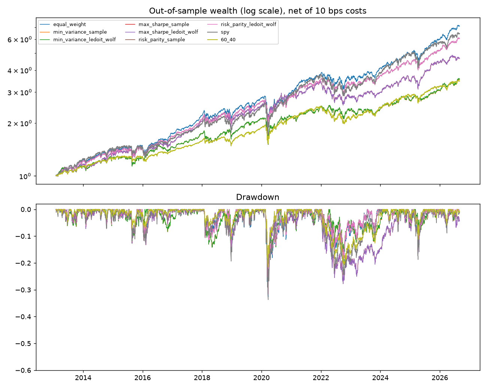
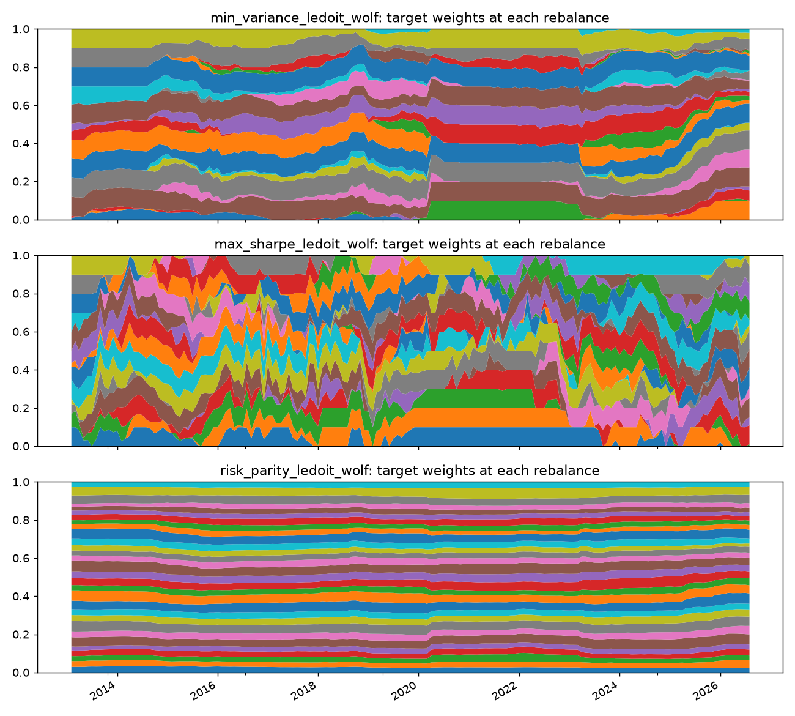

# Portfolio Risk Analytics

Portfolio construction and risk analysis for 30 US stocks using walk-forward backtests with transaction costs, Value at Risk estimation and backtesting, stress testing, and Fama-French factor attribution on freely available daily data. Out-of-sample results net of costs from 2013-02-01 to 2026-08-31. By Simran Kharbanda. All numbers below are read from results/data.json, results/backtest.json, results/risk.json, and results/factors.json produced by `python scripts/run_all.py`.

[](https://www.python.org/) [](https://pytest.org/) [](https://github.com/Sim2200/portfolio-risk-analytics/actions/workflows/ci.yml)

## Data

The portfolio universe consists of 30 large-cap US stocks: AAPL, MSFT, AMZN, GOOGL, JPM, JNJ, XOM, PG, UNH, HD, KO, PEP, CVX, MRK, PFE, WMT, DIS, CSCO, INTC, IBM, MCD, BA, CAT, MMM, GS, WFC, BAC, T, VZ, ORCL. Benchmarks are SPY and AGG. Daily adjusted closing prices from Yahoo Finance via yfinance cached in data/prices.csv span from 2010-01-05 to 2026-08-31 (4189 trading days). Ken French daily 5 factors plus momentum are sourced via pandas-datareader and end at 2026-08-31.

Survivorship bias: the 30 names were selected today and do not include companies delisted or failed between 2010 and the present. This biases single-strategy performance upward, but every portfolio construction method sees the same universe, making method comparisons meaningful.

## Methodology

Monthly rebalancing occurs on the last trading day of each month. Each strategy observes trailing daily returns from exactly 36 calendar months ending on the rebalance date and produces target weights. Those weights are held and drift with prices through the next calendar month. A transaction cost of 10 basis points applies to every dollar of one-way turnover, charged on the first trading day of the new month. The out-of-sample period is 2013-02-01 to 2026-08-31 (3415 days).

Expected returns are trailing sample means computed from the 36-month fit window. Two covariance estimators are compared: sample covariance and Ledoit-Wolf shrinkage. Portfolio construction uses three methods: (1) equal weight (baseline), (2) minimum variance subject to long-only, 10% per-asset cap, solved via SLSQP, and (3) maximum Sharpe ratio also subject to long-only and 10% cap, using multiple random starting points to handle non-convexity. Risk parity targets equal risk contribution per asset, also subject to the cap. Each optimization uses SLSQP with a 10% per-asset cap and long-only constraints.

Maximum Sharpe optimization starts from equal weight, minimum variance, and five random Dirichlet samples, retaining the solution with highest Sharpe ratio. Risk parity minimizes the sum of squared deviations between each asset's risk contribution and 1/n.

Benchmarks are buy-and-hold SPY (no rebalancing, no cost) and 60/40 SPY/AGG rebalanced monthly with 10 basis points costs. Look-ahead is prevented: no return in a test month is part of the fit window, verified by assertions in tests/test_backtest.py.

Value at Risk employs three methods at 1-day 99% confidence: historical (empirical quantile), parametric normal (mean and covariance fitted from the out-of-sample returns), and Monte Carlo on a multivariate normal fitted to asset-level daily returns using the strategy's mean out-of-sample weights. Kupiec's proportion-of-failures test on rolling 250-day windows rejects every VaR model at the 5% level.

Stress testing examines cumulative returns and drawdowns over two windows: COVID crash from 2020-02-19 to 2020-03-23 and 2022 rate shock from 2022-01-03 to 2022-10-12.

Factor exposure is estimated via daily OLS regression on the Fama-French 5 factors (Mkt-RF, SMB, HML, RMW, CMA) plus momentum (Mom) with Newey-West HAC standard errors at 5 lags. Alpha is annualized by multiplying daily estimates by 252.

## Results

### Out-of-sample performance (2013-02-01 to 2026-08-31, net of costs)

| Strategy | Ann. return | Ann. vol | Sharpe | Sortino | Max drawdown | Turnover (annual) | Cost drag (annual) | Worst year |
|---|---|---|---|---|---|---|---|---|
| equal_weight | 15.6% | 15.7% | **0.89** | 1.26 | -32.7% | 29% | 6 bps | 2022 (-6.6%) |
| min_variance_sample | 9.8% | 13.3% | 0.63 | 0.89 | -29.5% | 53% | 11 bps | 2022 (-4.7%) |
| min_variance_ledoit_wolf | 9.8% | 13.3% | 0.64 | 0.89 | -29.5% | 52% | 10 bps | 2022 (-4.6%) |
| max_sharpe_sample | 12.0% | 15.7% | 0.69 | 0.96 | -27.8% | 164% | 33 bps | 2022 (-18.2%) |
| max_sharpe_ledoit_wolf | 12.0% | 15.7% | 0.69 | 0.96 | -27.8% | 164% | 33 bps | 2022 (-18.2%) |
| risk_parity_sample | 14.2% | 14.8% | 0.85 | 1.21 | -31.7% | 29% | 6 bps | 2022 (-6.1%) |
| risk_parity_ledoit_wolf | 14.2% | 14.8% | 0.85 | 1.21 | -31.7% | 29% | 6 bps | 2022 (-6.1%) |
| spy | 14.7% | 16.8% | 0.80 | 1.12 | **-33.7%** | n/a | n/a | 2022 (-18.2%) |
| 60_40 | 9.6% | 10.4% | 0.76 | 1.07 | **-21.6%** | 9% | n/a | 2022 (-15.9%) |

Equal weight achieved the highest Sharpe ratio. Minimum variance cut volatility and drawdown but at the cost of return; its maximum position weighted 10% on average with an effective number of 12 holdings. Maximum Sharpe experienced high turnover (164% annually) and cost drag (33 bps) due to the 10% cap creating a non-convex constraint, requiring it to rebalance aggressively each month. Risk parity sat between equal weight and minimum variance, using 28 effective holdings on average. The 60/40 benchmark had the smallest maximum drawdown.

### Ledoit-Wolf shrinkage versus sample covariance

With 756 daily observations per fit window and 30 assets, the Ledoit-Wolf shrinkage intensity averaged 2.6% (minimum 1.3%, maximum 5.7%). Across 163 fit windows, sample and shrinkage-based covariances produced target weights differing by 0.0147 on average (absolute weight difference per asset summed, mean_abs_weight_difference for min_variance family). The two estimators' Sharpe ratios differed by at most 0.0081 within any period and produced nearly identical portfolio performance over the full sample. Ledoit-Wolf won in 4 of 5 subperiods for all three optimizer families, but these differences are not material at this problem scale. Shrinkage matters when sample sizes are small or the asset count is large; this data set is already well-determined.

### Value at Risk and expected shortfall (1-day, 99% confidence)

| Strategy | Historical VaR | Historical CVaR | Parametric VaR | Parametric CVaR | Monte Carlo VaR |
|---|---|---|---|---|---|
| equal_weight | 2.72% | 4.13% | 2.23% | 2.57% | 2.25% |
| min_variance_sample | 2.17% | 3.53% | 1.91% | 2.20% | 1.89% |
| min_variance_ledoit_wolf | 2.18% | 3.53% | 1.91% | 2.20% | 1.89% |
| max_sharpe_sample | 2.78% | 4.03% | 2.26% | 2.59% | 2.14% |
| max_sharpe_ledoit_wolf | 2.78% | 4.04% | 2.26% | 2.59% | 2.14% |
| risk_parity_sample | 2.59% | 3.93% | 2.11% | 2.42% | 2.12% |
| risk_parity_ledoit_wolf | 2.59% | 3.93% | 2.11% | 2.42% | 2.12% |
| spy | 3.00% | 4.36% | 2.40% | 2.76% | n/a |
| 60_40 | 1.83% | 2.72% | 1.48% | 1.70% | n/a |

Rolling VaR backtest results (250-day window, 99% confidence, 3165 test observations):

| Strategy | Method | Breaches | Expected | Breach rate | Kupiec p-value | Rejected |
|---|---|---|---|---|---|---|
| equal_weight | historical | 54 | 31.65 | 1.71% | 0.000286 | Yes |
| equal_weight | parametric | 79 | 31.65 | 2.50% | 0.000 | Yes |
| min_variance_sample | historical | 50 | 31.65 | 1.58% | 0.002506 | Yes |
| min_variance_sample | parametric | 73 | 31.65 | 2.31% | 0.000 | Yes |
| risk_parity_sample | historical | 56 | 31.65 | 1.77% | 0.000087 | Yes |
| risk_parity_sample | parametric | 78 | 31.65 | 2.46% | 0.000 | Yes |
| spy | historical | 49 | 31.65 | 1.55% | 0.00412 | Yes |
| spy | parametric | 89 | 31.65 | 2.81% | 0.000 | Yes |
| 60_40 | historical | 48 | 31.65 | 1.52% | 0.006647 | Yes |
| 60_40 | parametric | 86 | 31.65 | 2.72% | 0.000 | Yes |

Every rolling VaR model was rejected. Historical breaches ranged from 45 to 56 across strategies (expected 31.65); parametric was worse, ranging from 73 to 89 breaches. The 250-day window underestimates tail risk because volatility clusters and daily returns are fat-tailed. The normal parametric assumption is particularly inadequate. For equal weight, expected shortfall exceeded VaR by a factor of 1.52 (historical).

### Stress windows

| Strategy | COVID crash 2020-02-19 to 2020-03-23 | Rate shock 2022-01-03 to 2022-10-12 |
|---|---|---|
| | Cumulative return | Max drawdown | Cumulative return | Max drawdown |
| equal_weight | -31.9% | -32.2% | -17.2% | -20.3% |
| min_variance_sample | -28.9% | -29.0% | -14.5% | -16.6% |
| max_sharpe_sample | -27.1% | -27.3% | -25.0% | -26.4% |
| risk_parity_sample | -31.0% | -31.2% | -16.6% | -18.9% |
| spy | -33.4% | -33.7% | -24.1% | -24.5% |
| 60_40 | -21.4% | -21.6% | -20.4% | -20.4% |

The 60/40 benchmark lost least in both windows. Minimum variance shed less than equal weight during the COVID crash, but maximum Sharpe, tilted toward momentum and avoiding defensive factors, lost most in both. Risk parity positioned between equal and min variance.

### Factor attribution (Fama-French 5 + momentum)

| Strategy | Alpha (annual) | Alpha t-stat | Mkt-RF | SMB | HML | RMW | CMA | Mom | R^2 |
|---|---|---|---|---|---|---|---|---|---|
| equal_weight | 2.0% | 1.86 | 0.89 | -0.13 | 0.20 | 0.10 | 0.12 | -0.06 | 0.931 |
| min_variance_sample | -0.8% | -0.40 | 0.67 | -0.22 | -0.00 | 0.27 | 0.31 | -0.07 | 0.689 |
| max_sharpe_sample | -1.9% | -1.12 | 0.87 | -0.18 | -0.03 | 0.23 | 0.10 | 0.10 | 0.843 |
| risk_parity_sample | 1.4% | 1.11 | 0.84 | -0.15 | 0.14 | 0.16 | 0.18 | -0.07 | 0.898 |
| spy | -0.1% | -0.21 | 0.99 | -0.11 | 0.02 | 0.05 | 0.04 | -0.01 | 0.995 |
| 60_40 | -0.1% | -0.18 | 0.59 | -0.04 | -0.02 | 0.04 | 0.03 | -0.01 | 0.955 |

No alpha is statistically significant at the 5% level; the largest absolute t-statistic is equal_weight at 1.86. The construction methods tilt in distinct directions: minimum variance loads heavily on profitability (RMW 0.27) and investment (CMA 0.31) factors while cutting market beta (0.67 vs 0.89 for equal weight). Maximum Sharpe tilts toward momentum (0.10) and profitability (0.23). All show negative SMB exposure. The equal weight portfolio, despite highest alpha nominally, does not produce a statistically significant excess return after accounting for risk factor exposures.

## Figures



Out-of-sample wealth curves on log scale net of 10 basis points transaction costs and rolling drawdowns. SPY and 60/40 highlighted.



Target weights (at rebalance, before drift) for minimum variance, maximum Sharpe, and risk parity strategies using Ledoit-Wolf covariance, showing composition at each monthly rebalance from 2013 to 2026.

## Caveats

Survivorship bias: the fixed universe of 30 stocks excludes delisted or failed companies, biasing returns upward. Single-strategy results should be viewed with this in mind, though strategy-to-strategy comparisons are unaffected.

One universe, one parameter set: only 36-month fit windows, 10% position cap, and 10 basis points cost are tested. No parameter sweep, so no selection bias within this grid, but robustness to other windows, caps, or cost regimes is untested.

Transaction costs are a flat 10 basis points applied to one-way turnover and do not reflect bid-ask spreads, market impact, or ticker-specific costs.

Yahoo Finance adjusted prices may be revised; results are fixed at the download date.

The factor regression sample extends to the end of the Fama-French daily factor data (2026-08-31), truncating the out-of-sample window to this date.

VaR backtests employ a single 250-day window length; results for other windows are not shown.

Monte Carlo VaR assumes a multivariate normal distribution, which the backtests reject as too thin-tailed.

Results are one historical realisation and do not constitute a forecast or recommendation.

## Running it

Create a virtual environment, install dependencies (including dev extras for testing), run the 69 pytest tests, and generate all results and figures:

```bash
python -m venv .venv
.venv/bin/pip install -e ".[dev]"
.venv/bin/python -m pytest -q          # 69 tests, no network
.venv/bin/python scripts/run_all.py    # about 2 minutes on a laptop; writes results/*.json and figures
.venv/bin/python -m prisk.data --refresh   # re-download prices and factors (network)
```

## Layout

```
src/prisk/
  __init__.py              TRADING_DAYS constant
  data.py                  download, align, and cache price and factor data
  covariance.py            sample covariance, Ledoit-Wolf shrinkage
  optimizers.py            equal weight, min variance, max Sharpe, risk parity
  backtest.py              walk-forward backtest engine
  metrics.py               Sharpe, Sortino, drawdown, returns summary
  risk.py                  VaR, CVaR, Kupiec test, stress windows
  factors.py               Fama-French regression

scripts/
  run_all.py               entry point; produces results/*.json and figures

tests/
  test_*.py                unit tests (no external data)

data/
  prices.csv               cached Yahoo Finance adjusted closes
  factors.meta.json        factor data metadata

results/
  data.json                input dates, tickers, factor coverage
  backtest.json            out-of-sample returns, Sharpe, turnover, covariance comparison
  risk.json                VaR, CVaR, rolling backtest, stress test results
  factors.json             Fama-French regression output
  figures/wealth_drawdown.png    wealth curves and drawdowns
  figures/weights.png            target weights over time
```

## Author

Simran Kharbanda, github.com/Sim2200.
